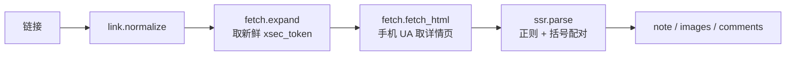
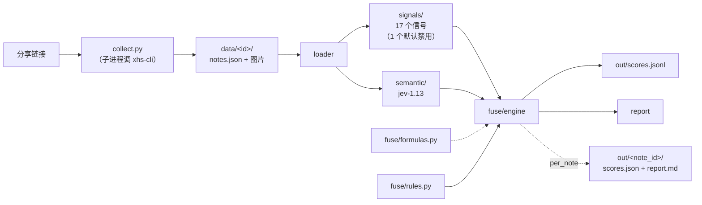

# L'Oréal Beauty Techathon · 小红书种草内容判别

给一个小红书分享链接，输出**「这篇内容是不是在引导读者购买」**的判定，
以及完整判定依据。

```powershell
python -m jev2 intake "https://xhslink.cn/o/3O20COBNbS1"
```

```
[1/3] 采集
      xhs-cli parse https://xhslink.cn/o/3O20COBNbS1 --out D:\LOreal-ai\data --json
      69d8c8a6000000002301d991 · 上海微调升级美貌，这就是原生高智脸的魅力~ · 图 5/5 · 评论 13/100
[2/3] 判定 · jev-1.13
      [1/1] 69d8c8a6 1.000 高风险 veto:ad_gate
[3/3] 报告
      69d8c8a60000 1.000 高风险 | veto:ad_gate | 主因 is_ad=0.97 is_cta=0.71

      [saved] D:\LOreal-ai\jev2\out\69d8c8a6000000002301d991\scores.json
      [saved] D:\LOreal-ai\jev2\out\69d8c8a6000000002301d991\report.md
```

**不需要 cookie、不需要登录、不需要浏览器。** 单篇约 1 秒 / $0.00006。

---

## 项目背景

### 业务问题

赛题来自 L'Oréal Beauty Techathon。要解决的是内容平台的一个核心问题：
**一篇看起来很真诚的笔记，到底是用户分享，还是在做投放？**

「种草」是小红书的核心内容形态，也是品牌投放的主要载体。
判断一篇笔记是自然分享还是商业引导，决定了品牌方该不该把它当口碑参考、
平台该不该给它打标、消费者该不该信它。

---

## Quick Start

### 0. 环境（首次，干净克隆后跑一次）

```powershell
cd d:\LOreal-ai

# 建 venv
python -m venv .venv
.\.venv\Scripts\Activate.ps1

# 装两个包（都只用标准库，--no-deps 即可）
python -m pip install -e xhs-cli --no-deps
python -m pip install -e jev2    --no-deps

# 配凭据（二选一）
$env:JEV2_API_KEY = "sk-..."      # 方式一：环境变量
# 方式二：登录过 opencode 就不用管，自动读 ~/.local/share/opencode/auth.json
```

装完 `xhs` 和 `jev2` 两个命令就都在 PATH 上了（venv 激活状态下）。

> ⚠️ **必须 `pip install -e`**，不能只 `cd` 进目录跑。
> `jev2/` 目录本身能被 Python 当成**空的命名空间包** import 成功，
> 于是 `python -m jev2` 会报一个和真实原因毫无关系的错。
> 装上之后任意 cwd 都能跑。

### 1. 环境自检

```powershell
python -m jev2 doctor
```

检查 key / 数据路径 / 模型连通 / 信号清单。模型不通会明确报出来
（比如上游 451），不会等到跑批才炸。

### 2. 一条命令：链接 → 报告

```powershell
python -m jev2 intake "https://xhslink.cn/o/3O20COBNbS1"
```

| 参数 | 说明 |
|---|---|
| `--no-images` | 不下载图片（判别不需要图，但人工复核需要） |
| `--no-semantic` | 只用统计信号，不调模型、不需要 key（分数**不构成判定结果**） |
| `--timeout N` | 采集超时秒数（默认 180） |

**退出码**：`0` 成功 · `2` 链接不支持或采集器没装（**重试没用**）·
`3` 抓取失败（**可重试**）· `4` 落盘失败。脚本靠这个决定要不要重试。

### 3. 分步跑（调试 / 批量用）

```powershell
# 采集（只落盘，不判别）
python -m xhs_cli parse "<链接>" --out data

# 只看统计信号 —— 零模型调用、不花钱
python -m jev2 signals --note 6ab6a30e

# 判别（单篇 / 全批）
python -m jev2 judge --note 6ab6a30e
python -m jev2 judge                    # 全批，默认跳过已判过的
python -m jev2 judge --per-note         # 全批 + 每篇都落单篇目录

# 出汇总报告（读已有结果，不调模型）
python -m jev2 report
python -m jev2 report --note 6ab6a30e   # 只出某篇，不调模型
```

调阈值时反复跑 `signals` 和 `report` 就行 —— 这两个都不花钱。

### 4. 产物在哪

```
data/<note_id>/                      ← 采集层产物
  01.jpg  02.jpg ...                 图片，序号对齐 notes.json 的 images 下标
  notes.json                         笔记 + 图片 + 评论（完整数据）

jev2/out/                            ← 判别层产物
  scores.jsonl                       全库汇总（一行一篇）
  REPORT.md                          汇总报告
  <note_id>/
    scores.json                      单篇完整结果（就是 jsonl 里那一行）
    report.md                        单篇可读报告（全部中间值）
```

`report.md` 是「这一篇凭什么这么判」的完整答案：

```markdown
## 结论         总分 / 档位 / 一票否决 / run_id / config_hash / 耗时
## 笔记         标题 / 作者 / 点赞 / 评论声明 vs 评论实得 / 图片数
## 语义维度     按风险值降序，带置信度与题型
## 统计信号     非零的按降序 + 缺失的连同原因单列
## 判定过程     规则逐条求值：动作 / 值 / 权重 / 贡献 / 说明
```

当前仓库状态：**43 篇采集 · 540 条评论 · 100 张图 · 43 篇已判定**
（低风险 24 · 中风险 10 · 高风险 9）。

> Windows 控制台按 GBK 解码 UTF-8，中文会乱码。数据本身没问题 ——
> 报告都落成了 UTF-8 文件，读文件最省事。或先 `chcp 65001`。

---

## 项目架构

两个子系统，一条单向链路：

```
分享链接
   │
   ├──[子进程]── xhs-cli ──────────→ data/<note_id>/{图片, notes.json}
   │                                  采集层：只负责「把数据拿到」
   │
   └──────────── jev2 ──────────────→ jev2/out/<note_id>/{scores.json, report.md}
                                      判别层：只负责「怎么判」
```

### 采集层：xhs-cli

```
xhs-cli/src/xhs_cli/
  core/                 ★ 采集链路（只用标准库）
    link.py             链接归一化：短链 / 长链 / 缺协议 → LinkRef
    fetch.py            urllib 直连 + 手机 UA（三条铁律都在这个文件开头）
    ssr.py              HTML → 结构化字段
    ssr_json.py         括号配对提取嵌套数组（评论 / tagList）
    service.py          parse_link()：重试 + 换 token
  cli.py                命令行入口（只有 parse 一个子命令）
```



### 判别层：jev2

```
jev2/src/jev2/
  collect.py            进料：链接 → data/（子进程调 xhs-cli）
  loader.py             notes.json → NoteRecord（唯一认识数据结构的地方）
  signals/              ★ 一信号一文件，注册表自动发现（17 个）
    base.py             @signal 装饰器 + SignalSet
    _lib.py             共享数学工具（纯函数）
  semantic/
    questions.py        问题注册表（措辞已 A/B 校准）
    provider.py         jev-1.13 HTTP 客户端
    runner.py           state 拼装 + 调用 + 归一化
  fuse/
    formulas.py         ★ 公式库：指标函数 + 逻辑门（纯函数）
    rules.py            ★ 规则集：声明式决策逻辑
    engine.py           求值引擎（写一次就不动）
  pipeline/
    runner.py           编排：load → signals → semantic → fuse → store
    store.py            scores.jsonl 读写（幂等）
  report.py             报告渲染（汇总 / 单篇）
  cli.py                命令行入口
```



数据流**单向**：`loader → signals/semantic → fuse → store`。
每层输入输出都是 `dataclass`，没有隐式共享状态。

### 仓库目录

```
d:\LOreal-ai\
├─ xhs-cli/           采集（匿名 HTTP，parse 路径只用标准库）
├─ jev2/              判别（信号 + 语义 + 融合）
│   ├─ config.toml    ★ 阈值 / 权重 / 规则集都在这里
│   └─ out/           产物
├─ data/              采集产物（43 篇，入库便于复现）
├─ docs/              设计与实测记录
└─ tools/  legacy-*  regression/     早期实现，不参与主链路
```

### 为什么切成两个子系统

唯一的**进程边界**就在采集器那里：

| | 采集 | 判别 |
|---|---|---|
| 会怎么挂 | 短链过期、反爬、验证码、网络抖动 | 模型 451、key 失效、数据格式变了 |
| 挂了怎么办 | 换链接 / 重试 | 看异常类型（跳过 / 中止 / 退避） |
| 换实现成本 | 低（换个采集器即可） | 高（规则都在里面） |

混在一个进程里就得写一套混合的异常处理；分开之后「采集崩了」直接变成
一个退出码，处置方式立刻明确。代价是多一次进程启动（约 0.3s），
和一份必须维护的 JSON 契约：

```
stdout  纯 JSON（可 json.loads）—— 顶层必须是 object，且含 note_id
stderr  进度信息（人读的，可忽略）
退出码  0 成功 · 2 链接不支持 · 3 抓取失败 · 4 落盘失败
```

jev2 会逐项校验这份契约，包括最难发现的一种失败：
**「采集器报成功，但文件没落盘」** —— 不在这里拦住，就会带着一个
不存在的路径一路走到 loader 才报错，那时已经看不出是采集的问题了。

### 数据契约

`data/<note_id>/notes.json` 是两层之间**唯一**的接口。
判别层不认识小红书，只认识这个结构（`loader.py` 是唯一解析它的地方）。

```jsonc
{
  "note_id": "6ac3c7f4000000001b02fc03",
  "note": {
    "title": "…", "desc": "…", "author": "…",
    "liked": "7546",            // ⚠️ 计数都是字符串
    "comment_count": "523",     // 页面声明的总数（一级 + 楼中楼）
    "time_ms": "1791215604000", // 毫秒时间戳，字符串
    "tags": ["…", "…"],         // ⚠️ 有重复项，需清洗
    "images": ["http://…!h5_1080jpg"]
  },
  "comments": [
    { "nickname": "…", "content": "…", "ip_location": "山东",
      "like_count": "0", "time": 1791470300000,
      "is_author": false, "_is_reply": false }
  ],
  "declared": 523, "got": 20, "complete": false,
  "image_files": ["01.jpg"], "image_errors": []
}
```

`loader.py` 会丢掉**没有正文的评论**（无内容可判）——
原始 543 行 → 解析后 540 行，`jev2 doctor` 报的是后者。

---

## 原理

### 采集：为什么不用浏览器、不用 cookie

三条铁律（`xhs-cli/src/xhs_cli/core/fetch.py` 开头，实测得出，不要改）：

1. **必须手机 UA。** 桌面 UA 会 302 到登录页，而 **HTTP 状态码仍是 200** ——
   只判状态码会静默拿到一个废页面。所以展开后必须校验最终 URL。
2. **必须 `urllib`。** 实测它的 TLS 指纹能过。
   `requests` / `httpx` / `curl_cffi` **未验证，不要替换**。
3. **不复用连接。** 不开 `Session`、不加 keep-alive，每次新建 `Request`。

**短链优先**：短链每次展开都由平台**新签发** `xsec_token`；
长链里写死的 token 几小时就失效。所以优先保存短链。

**SSR 是 JS 字面量，不是 JSON** —— 详情页把数据塞在 HTML 的 JS 对象里，
含 `undefined`、尾随逗号，不能直接 `json.loads`：

```
HTML
 ├─ prepare()      只反转义 \u002F 与 \/（不碰 \" —— 会切断字段边界）
 ├─ 正则取标量      title / desc / likedCount / shareCount ...
 ├─ 括号配对取数组  "commentData":{"comments":[ → 深度扫描跳过字符串与转义 → json.loads
 └─ 摊平           一级评论在前，其楼中楼紧跟其后
```

**评论为什么必须括号配对**：SSR 里一级评论的 `user` 与 `content` 之间
隔着整个 `subComments` 数组（实测 1000~1500 字），任何「最近距离配对」都会错配；
而且 `user` 相对 `content` 的位置在一级评论与楼中楼里**正好相反**。
按括号配对取整段 JSON 是唯一不依赖字段顺序的做法。

**降级链**（最长 4 次尝试）：

```
HTTP 直连
  ↓ token 类失败（detail_http_* / expand_no_token / expand_login）
重新展开短链换新 token
  ↓ 拿到 HTML 但关键字段全空（EmptyDataError）
重新展开短链换新 token
  ↓ 限流 / 网络类失败
指数退避 1s → 2s → 4s
  ↓ 仍失败
抛 FetchError（带 kind，见 xhs-cli/README.md）
```

### 判别：三层，各管一件事

```
notes.json
   ↓ loader
NoteRecord
   ├─→ signals/     17 个统计信号    → SignalResult（value = 风险值 0..1）
   └─→ semantic/    jev-1.13 四维度  → DimScore
                        ↓
                    fuse/engine（规则集 + 公式库）
                        ↓
                    Verdict → out/
```

**信号层**测「行为痕迹」——不读内容，只算数字：

| 信号 | 测什么 | 方向 | AUC |
|---|---|---|---:|
| `comment_len_mean` | 评论平均长度 | 越短越可疑 | **0.809** |
| `comment_len_sd` | 评论长度标准差 | 越小越可疑 | 0.785 |
| `comment_len_iqr` | 长度四分位距 | 越小越可疑 | 0.761 |
| `low_effort_ratio` | 低信息量评论占比 | 越高越可疑 | 0.742 |
| `comment_time_span` | 评论时间跨度 | 越集中越可疑 | 0.737 |
| `text_exclaim_density` | 感叹号密度 | 越高越可疑 | 0.714 |
| `like_comment_ratio` | 赞评比 | 越高越可疑 | 0.714 |
| `cta_lexicon` | 引导词词表（私信/优惠券…） | 密度越高越可疑 | 0.697 |
| `structure_markers` | 模板排版（✅1️⃣💡） | 标记越多越可疑 | 0.680 |
| `tag_count` | 话题标签个数（SEO 堆砌） | 越多越可疑 | 0.643 |
| `sub_reply_ratio` | 楼中楼占比 | 越低越可疑 | 0.603 |
| `ip_top1_ratio` | IP top1 占比 | 越高越可疑 | 0.511 |
| `author_reply_ratio` | 作者自评占比 | 越高越可疑 | 0.495 |
| `ip_entropy` | IP 分布熵 | 越低越可疑 | 0.460 |
| `text_length` | 正文长度 | 两个极端可疑 | 0.424 |
| `comment_like_rate` | 评论点赞非零率 | 越低越可疑 | 全缺失 |
| `nickname_dup_rate` | 昵称重复率 | **已禁用** | 0.259 反向 |

> AUC = 「随机抽一对（高风险, 非高风险），高风险那篇的值更大的概率」
> （Mann-Whitney）。0.5 = 无区分力。
>
> 上表口径是 **vs 高风险**。同一个信号换个口径会差很多 ——
> 比如 `tag_count` vs 高风险 0.643，vs「高风险+中风险」0.734。
> 引数字时先说清口径。

> `value` 是**风险值**（0..1，越大越可疑），原始测量值在 `detail` 里。
> 比如 `comment_len_sd` 的 `value=0.0` 意思是「这个维度没发现可疑」，
> 不是「计算失败」—— 原始 SD 在 `detail.sd`。

**语义层**读内容，判四个维度：`is_ad` / `has_risk` / `exaggeration` / `is_cta`。

其中 `is_cta` 问的是「有没有明确要求或建议**读者**采取购买行动」
（下单、询价、选色号、购买前先做某事…）。它刻意**不参与一票否决** ——
「像广告」不等于「是 CTA」，一篇成分党硬核测评可以很营销但并没有让读者买什么。

**融合层**是声明式规则 + 纯函数公式库：

```toml
weights = { has_risk = 0.35, exaggeration = 0.30, is_ad = 0.25, is_cta = 0.10 }
veto    = { is_ad = 0.85 }
high    = 0.60
low     = 0.30
```

```python
Rule(name="ad_gate",
     action="veto",                      # veto | contribute | flag
     formula=indicator_ge,
     args={"t": 0.85},                   # 参数是数据，不是代码
     inputs=("is_ad",))
```

**一票否决只有 `is_ad ≥ 0.85`**。依据：加权平均会把纯广告稀释
（官方活动贴 `is_ad=0.96` 被拉到加权 0.642 → 误判中风险），
加这道门后高风险召回 40% → 100%。但**不能让 `is_cta` 也短路** ——
曾经放开过，结果 `is_cta=0.88` 误判了一篇成分党硬核测评。
**强引导 ≠ 高风险。**

### 四条核心原则

**1. 引擎写一次，内容全部数据化。** 每个「还没敲定」的量都有一个专门的接缝：

| 想改什么 | 动哪里 |
|---|---|
| 加一个统计信号 | `signals/` 丢个新文件 + `@signal` 装饰器 —— 自动发现 |
| 加一个语义维度 | `questions.py` 注册 spec + config 的 `dims` / `weights` |
| 改融合逻辑 | `fuse/rules.py` 换规则集，或 config 改 `weights` / `veto` |
| 改档位阈值 | config 的 `high` / `low`（想二值化就让 `low == high`） |

**2. 缺失是一等公民。** 样本不足时信号返回 `missing` + 原因，**绝不返回 0**。
「0 风险」和「没法算」是两回事 —— 混同会让报告把「没数据」显示成「很干净」。
融合时缺失的规则被跳过并记录，分母也相应扣掉。

**3. 权重全部来自语义维度。** 17 个统计信号**一个都不直接计分**，
只通过 `l2_stats` 规则以 `flag` 动作被记录，供调阈值时参考。
后果：**没跑语义层 = 没有分数**。所以 `--no-semantic` 跑出来的
`0.000 低风险` 不是「内容干净」，而是「什么都没判」——
终端和报告都会打警告，而且那些结果不算「已判过」，重跑会重判。

**4. 上游挂了就别装作跑完了。** 语义层失败分两种，处置完全不同：

| 情况 | 处置 |
|---|---|
| 单篇偶发失败 | 该篇继续（`semantic_ok=false`），并声明「分数只含统计信号」 |
| **连续 3 篇失败** | **中止整批**，退出码 4 |

上游 451（`Endpoint is unavailable`）会让**每一篇**都失败。不熔断就会一路
跑完，把整批写成「总分全 0 · 低风险」—— 而那个结果和「40 篇确实都干净」
**长得一模一样**。

### 实测结果

**离线评估**（基准：逐篇人工判读 40 篇）：

| 指标 | 阈值 0.70 | 阈值 0.60 + 3 个新信号 |
|---|---:|---:|
| 二值一致率 | 97.5% | **100%** |
| 三档一致率 | 75.0% | **77.5%** |
| kappa | 0.560 | **0.606** |
| 高风险 F1 | 0.923 | **1.000** |

**成本与速度**：40 篇全跑约 35 秒 / **$0.0019**（单篇约 $0.00006）。
调阈值不需要重跑模型 —— `scores.jsonl` 里存了全部中间值。

### 已知限制

**数据源限制（匿名态）**：

| 限制 | 影响 |
|---|---|
| 一级评论**只有 5 条** | 楼层数被锁在 5；总条数可以远超（楼中楼能带出几十上百条） |
| 评论 `like_count` **恒为 0** | `comment_like_rate` 恒 missing —— 主动返回 missing 带原因，不拿它当刷评证据 |
| 帖子 IP 属地**拿不到** | 试过 13 个候选键名，note 区 0 命中；评论 IP 可得 |
| 评论翻页返回 461 | 第 6 条一级评论起拿不到 |
| `tags` 有重复项 + 混入假标签「笔记」 | 读之前必须清洗 |

**方法限制**：

- 阈值 0.60 是在同一批 40 篇上调的，属于**「在考卷上改答案」**，
  换一批数据验证前只能算候选值
- `nickname_dup_rate` 实测 **AUC 0.259（方向是反的）**，已禁用 ——
  它实际测的是「默认昵称流行度」（官方活动帖评论者全是唯一昵称，
  个人真实帖反而一堆 `momo`），不是「刷评」
- 权重继承自早期系统（已验证二值一致率 95.8%），
  **没有 ground truth 之前不要随手改** —— n=40 时新权重就是过拟合
- `comment_time_span` 只测首屏那 5 条一级评论的内部跨度，
  不是整个评论区的活跃曲线，所以风险上限压到 0.6

**阈值为什么必须按实测分位数定**：初版 14 个信号里有 6 个阈值完全落在
分布之外（信号恒 0 这种**静默失效**）。所以每个信号文件里都写了取值依据，
改之前先读 docstring。

---

## 开发

```powershell
# 265 个用例（jev2 226 + xhs-cli 39）
python -m pytest jev2/tests xhs-cli/tests -q
```

测试重点锁三类东西：

1. **风险方向** —— 每个信号「越大越可疑」还是「越小越可疑」。
   写反过两次（`band_risk` 逻辑倒置、`ip_entropy` 条件写错），
   两次都是「信号恒 0」这种静默失效，不测根本发现不了
2. **缺失语义** —— 样本不足必须 missing + 原因，不能返回 0
3. **可扩展性** —— 换规则集 / 加权重键 / 自动发现信号都要有测试兜住

改动前先读两处注释：`xhs-cli/src/xhs_cli/core/fetch.py` 的三条铁律、
`jev2/src/jev2/semantic/provider.py` 的坑列表（Cloudflare UA、451 可重试等）。

---

## 文档索引

| 文件 | 内容 |
|---|---|
| `jev2/README.md` | 判别系统详解：信号清单、公式库、规则集、评估 |
| `xhs-cli/README.md` | 采集详解：三条铁律、SSR 解析、字段可用性、失败分类 |
| `docs/JEV2_PLAN.md` | 框架设计总纲（扩展点与接缝） |
| `docs/JEV2_EVALUATION.md` | 首轮评估：逐篇人工判读 40 篇做基准 |
| `docs/XHS_SITE_IMPL.md` | HTTP 采集路线的实现说明 |
| `docs/DATA_COMPLETENESS.md` | 采集数据完整性审计（哪些字段拿得到） |
| `docs/BATCH_PULL.md` | 批量拉取 42 篇的过程与失败分类 |
| `docs/UA_PROBE.md` / `docs/FAILED_2_PROBE.md` | UA 探测与两篇失败帖的逐项诊断 |
| `jev2/docs/JEV2_PROTOTYPE_ROUND2.md` | 第二轮离线原型：新信号 AUC + 公式变体对比 |

---

## 合规

仅用于公开可见内容的采集与分析。请遵守平台服务条款与当地法规，
不得用于规模化抓取、用户数据画像或商业竞争用途。

采集已内置请求间隔，请勿高频批量抓取。
