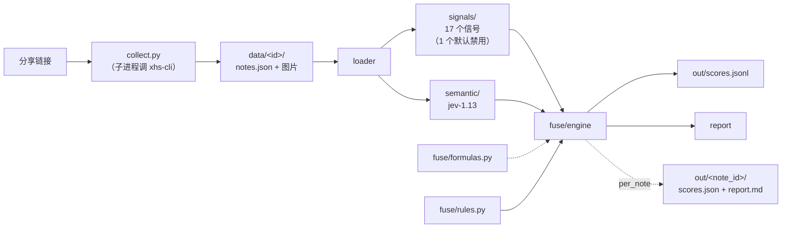

# jev2

种草真实性判别系统：**统计信号 + jev-1.13 语义判定 + 可配置融合**。

输入 `data/<note_id>/notes.json`，输出每篇的三档判定（高/中/低风险）+ 完整判定依据。

---

## 安装

```powershell
cd jev2
D:\LOreal-ai\.venv\Scripts\python.exe -m pip install -e . --no-deps
```

只用标准库，`--no-deps` 即可。凭据不写在任何文件里（见下）。

### 凭据

```powershell
# 方式一：环境变量
$env:JEV2_API_KEY = "sk-..."

# 方式二：用 opencode 的凭据（已登录就不用管）
#   从 ~/.local/share/opencode/auth.json 读 opencode-go provider
```

日志和产物里永远只有掩码形式（`sk-E...OC9a(len=67)`），
`Config.to_dict()` **没有**返回明文的口子。

---

## Quick Start

### 产品入口：给一个链接

```powershell
python -m jev2 intake "https://xhslink.cn/o/3O20COBNbS1"
```

一条命令跑完采集 → 判定 → 报告：

```
[1/3] 采集
      xhs-cli parse https://xhslink.cn/o/3O20COBNbS1 --out D:\LOreal-ai\data --json
      落盘 D:\LOreal-ai\data\69d8c8a6000000002301d991
      69d8c8a6000000002301d991 · 上海微调升级美貌，这就是原生高智脸的魅力~ · 图 5/5 · 评论 13/100
[2/3] 判定 · jev-1.13
      [1/1] 69d8c8a6 1.000 高风险 veto:ad_gate
[3/3] 报告
      69d8c8a60000 1.000 高风险 | veto:ad_gate | 主因 is_ad=0.97 is_cta=0.70

      [saved] D:\LOreal-ai\jev2\out\69d8c8a6000000002301d991\scores.json
      [saved] D:\LOreal-ai\jev2\out\69d8c8a6000000002301d991\report.md
```

退出码：`0` 成功 · `2` 链接不被支持（**重试没用**）·
`3` 抓取失败（可重试）· `4` 落盘失败 · `2` 采集器没装。

> 采集器（`xhs-cli`）是**独立进程**：它挂了不会拖垮判定，
> 换一个采集器也不用改判定层。见「采集与判定的分界」。

### 手工链路：分步跑

```powershell
# 1. 环境自检（key / 数据 / 模型连通 / 信号清单）
python -m jev2 doctor

# 2. 只看统计信号 —— 零模型调用、不花钱
python -m jev2 signals --note 6ab6a30e

# 3. 跑判定（信号 + 语义 + 融合）
python -m jev2 judge

# 4. 出报告（读已有结果，不调模型）
python -m jev2 report

# 5. 只要某一篇 —— 落 out/<note_id>/{scores.json, report.md}
python -m jev2 judge --note 6ab6a30e
```

40 篇全跑约 **35 秒 / $0.0019**。

---

## 命令与参数

| 命令 | 作用 | 调模型 |
|---|---|---|
| `doctor` | 环境自检 | 1 次探测 |
| **`intake <链接>`** | **链接 → 采集 → 判定 → 报告** | ✅ |
| `signals` | 只看统计信号 | ❌ |
| `judge` | 完整判定 | ✅ |
| `report` | 出报告 | ❌ |
| `rules` | 列出规则集与权重 | ❌ |
| `calibrate` | 阈值扫描（需标注文件） | ❌ |

### `intake`

| 参数 | 说明 |
|---|---|
| `link` | 小红书分享链接（短链 / 长链） |
| `--no-images` | 不下载图片（判定不需要图，但人工复核需要） |
| `--no-semantic` | 只用统计信号（不调模型、不需要 key）—— 见下方说明 |
| `--timeout N` | 采集超时秒数（默认 180） |

> `--no-semantic` 的分数**不构成判定结果**：融合权重全部来自语义维度
> （见「融合权重全部来自语义维度」）。它只用来核对统计信号，
> 跑出来的 0.000 不是「内容干净」。

### `signals`

| 参数 | 说明 |
|---|---|
| `--note PREFIX` | 只跑某篇（note_id 前缀） |
| `--out FILE` | 输出到文件（默认打到终端） |

### `judge`

| 参数 | 说明 |
|---|---|
| `--note PREFIX` | 只跑某篇（默认开单篇产物） |
| `--limit N` | 最多跑几篇 |
| `--force` | 重跑已有结果的篇（默认跳过，省钱） |
| `--no-semantic` | 只用统计信号，**不调模型、不需要 key**（分数不构成判定结果） |
| `--per-note` | 额外为**每篇**落 `out/<note_id>/{scores.json, report.md}` |
| `--report` | 跑完出简报 |
| `--report-path FILE` | 把 Markdown 报告写到该文件 |

### `report`

| 参数 | 说明 |
|---|---|
| `--note PREFIX` | 只出某篇的**单篇**报告，落 `out/<note_id>/`（不调模型） |
| `--top N` | 风险清单条数（默认 15） |
| `--out FILE` | 输出路径（默认 `out/REPORT.md`） |

### `calibrate`

| 参数 | 说明 |
|---|---|
| `--labels FILE` | 人工标注（JSONL），格式见下 |

```jsonl
{"note_id": "6ab6a30e0000000015000da7", "label": "high"}
{"note_id": "6931e77a000000001e033f7b", "label": "low"}
```

全局参数：`--config FILE` 指定配置文件，`--version`。

---

## 架构

```
jev2/src/jev2/
  config/
    schema.py           所有配置的 dataclass + schema_version
    __init__.py         load_config()：默认 → 文件 → 环境变量 → overrides
  core/
    types.py            NoteRecord / SignalResult / DimScore / Verdict
    errors.py           异常层级（不同异常不同处置）
    registry.py         通用注册表（信号与问题共用）
  collect.py            ★ 进料：链接 → data/<note_id>/（子进程调 xhs-cli）
  loader.py             notes.json → NoteRecord（唯一认识数据结构的地方）
  signals/              ★ 一信号一文件，注册表自动发现
    base.py             @signal 装饰器 + SignalSet
    _lib.py             共享数学工具（纯函数）
    comment_len_sd.py   ……共 17 个信号（16 启用 + 1 默认禁用）
  semantic/
    provider.py         jev-1.13 HTTP 客户端（坑都实测过）
    questions.py        问题注册表（措辞已 A/B 校准）
    runner.py           state 拼装 + 调用 + 归一化
  fuse/
    formulas.py         ★ 公式库：指标函数 + 逻辑门（纯函数）
    rules.py            ★ 规则集：声明式决策逻辑
    engine.py           求值引擎（写一次就不动）
  pipeline/
    runner.py           编排：load → signals → semantic → fuse → store
    store.py            scores.jsonl 读写（幂等）
  report.py             报告渲染（汇总 render_markdown / 单篇 render_note_detail）
  cli.py                命令行入口
```



---

## 原理

### 采集与判定的分界

整条链路只有一个**进程边界**，就在采集器那里：

```
链接 ──[子进程]──> xhs-cli ──> data/<id>/ ──[同进程]──> jev2 判定
```

为什么采集要独立出去：

| | 采集 | 判定 |
|---|---|---|
| 会怎么挂 | 短链过期、反爬、验证码、网络抖动 | 模型 451、key 失效、数据格式变了 |
| 挂了怎么办 | 换链接 / 重试 | 看异常类型（跳过 / 中止 / 退避） |
| 换实现成本 | 低（换个采集器即可） | 高（规则都在里面） |

混在一个进程里就得写一套混合的异常处理；分开之后「采集崩了」直接变成
一个退出码，处置方式立刻明确。代价是多一次进程启动（约 0.3s），
和一份必须维护的 JSON 契约：

```
stdout  纯 JSON（可 json.loads）—— 顶层必须是 object，且含 note_id
stderr  进度信息（人读的，可忽略）
退出码  0 成功 · 2 链接不支持 · 3 抓取失败 · 4 落盘失败
```

这份契约是**实测**的（`--json` 的 stdout 无任何杂质前缀），jev2 会逐项检查。
其中最难发现的一种失败是「采集器报成功、但文件没落盘」—— 不在这里拦住，
就会带着一个不存在的路径一路走到 loader 才报错，那时已经看不出是采集的问题。

`intake` 的退出码直接沿用采集器的（2 / 3 / 4），所以脚本能区分
「链接不对，重试没用」和「抓取失败，可以重试」。

### 核心原则：引擎写一次，内容全部数据化

框架里每个「还没敲定」的量都有一个**专门的接缝**，改它不用动引擎：

| 想改什么 | 动哪里 |
|---|---|
| 加一个统计信号 | `signals/` 丢个新文件，写 `@signal` 装饰器 —— 自动发现 |
| 加一个语义维度 | `questions.py` 注册 spec + `config.toml` 的 `dims` + `weights` |
| 改融合逻辑 | `fuse/rules.py` 换规则集，或 config 改 `weights`/`veto` |
| 改档位阈值 | config 的 `high` / `low`（想二值化就让 `low == high`） |
| 启用 L2 统计信号计分 | config 的 `weights` 加一个 `l2_mean` 键 |

### 三层分工

```
L2 统计信号  →  Python 算（免费、可解释）
L1 语义维度  →  jev-1.13 判（花钱，但能读懂话）
融合         →  加权 + 一票否决
```

**统计信号不喂给模型** —— jev 是语义判断器，给它「SD=5.62」它算不过 Python。

### 一票否决（veto）

只有 `is_ad >= 0.85` 能一票判高风险。依据来自 legacy-jev 的实测：

- 加权平均会把纯广告稀释：官方活动贴 `is_ad=0.96` 被拉到加权 0.642 → 误判中风险
- 加这道门后**高风险召回 40% → 100%**
- **但不能让 `is_cta` 也短路** —— 曾经放开过，结果 `is_cta=0.88` 误判了一篇成分党硬核测评。**强引导 ≠ 高风险**

### 缺失是一等公民

样本不足时信号返回 `missing` + 原因，**绝不返回 0**。
「0 风险」和「没法算」是两回事 —— 混同会让报告把「没数据」显示成「很干净」。
融合时缺失的规则被跳过并记录，分母也相应扣掉。

### 融合权重全部来自语义维度

这是个容易被忽略、但决定了很多行为的事实：

```
has_risk      0.35
exaggeration  0.30
is_ad         0.25
is_cta        0.10
              ────
              1.00   ← 全部是语义维度
```

17 个统计信号**一个都不直接计分**，它们只通过 `l2_stats` 规则以 `flag`
动作被记录（`l2_mean`），供调阈值时参考。

后果：**没跑语义层 = 没有分数**。所以 `--no-semantic` 跑出来的
`0.000 低风险` 不是「内容干净」，而是「什么都没判」。

这不是 bug（统计信号里 AUC 最高的 `comment_len_mean` 也才 0.809，
单独用不足以判定），但它意味着 `--no-semantic` 的结果**不能覆盖**真实判定。
所以：

- 终端简报和单篇报告里都会打 ⚠️ 提示（「分数不构成判定结果」）
- 那些行（`model=""`）不算「已有结果」，重跑时会重判

### 幂等与可追溯

- `scores.jsonl` 按 `note_id` upsert，重跑不重复
- 每行带 `run_id` / `config_hash` / `schema_version` ——
  改了阈值之后，新旧结果能区分（报告里会警告「混了 N 次运行」）
- 每行的 `trace` 记录每条规则算出了什么、有没有跳过、贡献多少
- **`semantic_ok=false` 和 `model=""` 的篇不算「已有结果」** ——
  重跑时会自动重判。否则一次上游故障（或一次 `--no-semantic` 调试）
  就被永久固化进结果，而 `--force` 是整批重新花钱，不该是唯一出路

### 上游挂了就别装作跑完了

语义层失败分两种，处置完全不同：

| 情况 | 处置 |
|---|---|
| 单篇偶发失败 | 该篇继续（`semantic_ok=false`），并声明「分数只含统计信号」 |
| **连续 3 篇失败** | **中止整批**，退出码 4 |

为什么必须熔断：上游 451（`Endpoint is unavailable`）会让**每一篇**
都失败。不熔断就会一路跑完，把整批写成「总分全 0 · low」——
而那个结果和「40 篇确实都干净」**长得一模一样**。

```
[X] 整批中止：连续 3 篇语义层调用失败（上游 451/限流），已中止整批
[6/40] → 剩下 34 篇未跑
```

`--no-semantic` 不调模型，不受熔断影响。

---

## 输出

### `out/scores.jsonl`

每篇一行：

```jsonc
{
  // ── 元信息（每次运行都带）──
  "schema_version": 1,
  "run_id": "20261011-012318-37bcc8",
  "config_hash": "7f03405582a9",
  "model": "jev-1.13",
  "rule_set": "default",
  "scored_at": "2026-10-11T01:23:18",

  // ── 裁决 ──
  "note_id": "6ab6a30e0000000015000da7",
  "total": 1.0,                  // 0..1
  "level": "high",               // low | medium | high
  "level_label": "高风险",
  "vetoed_by": "ad_gate",        // 被哪条一票否决命中（空 = 没有）
  "notes": ["一票否决命中：ad_gate（is_ad ≥ 0.85 …）"],

  // ── 语义维度 ──
  "dimensions": {
    "is_ad":        {"name": "is_ad", "value": 0.94, "confidence": null},
    "has_risk":     {"name": "has_risk", "value": 0.67, "confidence": null},
    "exaggeration": {"name": "exaggeration", "value": 0.41, "confidence": 0.85},
    "is_cta":       {"name": "is_cta", "value": 0.48, "confidence": null}
  },

  // ── 统计信号（含缺失）──
  "signals": {
    "comment_len_sd": {
      "name": "comment_len_sd", "value": 0.0, "n": 18,
      "missing": false, "missing_reason": "",
      "detail": {"sd": 22.02, "mean": 26.0, "min_len": 6, "max_len": 120}
    },
    "comment_like_rate": {
      "name": "comment_like_rate", "value": null, "n": 20,
      "missing": true,
      "missing_reason": "20 条评论点赞全为 0 —— 疑似匿名态未填充该字段，不作为刷评证据"
    }
  },

  // ── 判定过程（调阈值时的依据）──
  "trace": [
    {"rule": "ad_gate", "action": "veto", "value": 1.0, "weight": 0.0,
     "contribution": 0.0, "skipped": false, "reason": "is_ad=1.000 ≥ 0.85"},
    {"rule": "risk", "action": "contribute", "value": 0.67, "weight": 0.35,
     "contribution": 0.2345, "skipped": false, "reason": ""},
    {"rule": "l2_stats", "action": "flag", "value": 0.323, "weight": 0.0,
     "contribution": 0.0, "skipped": false,
     "reason": "l2_mean=0.323（仅记录，不计分）"}
  ],

  "semantic_ok": true,
  "elapsed_ms": 812,
  "note": {"title": "惊喜盒子｜小棕瓶限时掉落", "author": "雅诗兰黛",
           "liked": 3961, "comment_count": 1311, "comments_got": 18, "images": 2}
}
```

`semantic_ok: false` 表示该篇模型调用失败，**分数只含统计信号**（会偏低）——
这不是「判定为干净」，报告里会单独警告。

### `out/<note_id>/`（单篇产物）

单篇模式（`judge --note` / `report --note`）**同时**落这两个文件；
`judge --per-note` 则给每篇都开一个目录：

```
out/6a7ebdfe00000000080122b8/
├── scores.json    # 就是 scores.jsonl 里那一行（json.dumps indent=2）
└── report.md      # 单篇可读报告
```

区别于汇总产物的关键：**这两个文件里只有这一篇**。

`report.md` 比汇总报告详细得多 —— 单篇的全部中间值：

```
# jev2 单篇判定：`6a7ebdfe00000000080122b8`

## 结论         总分 / 档位 / 一票否决 / run_id / config_hash / 耗时
## 笔记         标题 / 作者 / 点赞 / 评论声明 vs 评论实得 / 图片数
## 语义维度     按风险值降序，带置信度与题型
## 统计信号     非零的按降序 + **缺失的连同原因单独列出**
## 判定过程     规则逐条求值：动作 / 值 / 权重 / 贡献 / 说明
```

终端同时打一行简报：

```
6a7ebdfe0000 0.765 高风险 | 主因 exaggeration=0.98 is_ad=0.63
```

> 为什么单篇 `scores.json` 要和 jsonl 那一行**逐字一致**：
> 两份产物能互相印证，不会出现「按 jsonl 统计的分布」和
> 「按单篇目录复核的结果」对不上这种问题。

### `out/REPORT.md`

```
- 共 40 篇
- 档位：高风险 6 · 中风险 9 · 低风险 25
- 一票否决命中：3 篇
- 总分：min 0.035 · 中位 0.189 · max 1.000 · 均 0.316

## 风险最高的 20 篇
| # | note_id | 总分 | 档位 | 主要维度 | 否决 | 标题 |
...
## 语义维度分布
## 统计信号分布
## 最高分那篇的判定过程
```

---

## 17 个统计信号（16 启用 + 1 禁用）

信号按**实测 AUC**（vs「是否高风险」，40 篇）排序说明价值：

| 信号 | 测什么 | 方向 | AUC | 状态 |
|---|---|---|---:|---|
| `comment_len_mean` | 评论平均长度 | 越短越可疑 | **0.809** | ✅ 最强 |
| `comment_len_sd` | 评论长度标准差 | 越小越可疑 | 0.785 | ✅ |
| `tag_count` | 话题标签个数（SEO 堆砌） | 越多越可疑 | 0.734 | ✅ 第二轮新增 |
| `comment_len_iqr` | 长度四分位距 | 越小越可疑 | 0.761 | ✅ |
| `low_effort_ratio` | 低信息量评论占比 | 越高越可疑 | 0.742 | ✅ |
| `comment_time_span` | 评论时间跨度 | 越集中越可疑 | 0.737 | ✅ |
| `text_exclaim_density` | 感叹号密度 | 越高越可疑 | 0.714 | ✅ |
| `like_comment_ratio` | 赞评比 | 越高越可疑 | 0.714 | ✅ |
| `cta_lexicon` | 引导词词表（私信/优惠券…） | 密度越高越可疑 | 0.697 | ✅ 第二轮新增 |
| `structure_markers` | 模板排版（✅1️⃣💡） | 标记越多越可疑 | 0.680 | ✅ 第二轮新增 |
| `sub_reply_ratio` | 楼中楼占比 | 越低越可疑 | 0.603 | ⚠️ 弱 |
| `ip_top1_ratio` | IP top1 占比 | 越高越可疑 | 0.511 | ⚠️ 本样本无证据 |
| `author_reply_ratio` | 作者自评占比 | 越高越可疑 | 0.495 | ⚠️ 本样本无证据 |
| `ip_entropy` | IP 分布熵 | 越低越可疑 | 0.460 | ⚠️ 本样本无证据 |
| `text_length` | 正文长度 | 两个极端可疑 | 0.424 | ⚠️ 本样本无证据 |
| `comment_like_rate` | 评论点赞非零率 | 越低越可疑 | — | ⚠️ 全缺失 |
| `nickname_dup_rate` | 昵称重复率 | **已禁用** | 0.259 | 🚫 反向 |

**阈值全部按实测分位数定的，不是拍脑袋**。改阈值前先看
`signals/*.py` 里各自的 docstring —— 那里写了取值依据。

### 为什么 `nickname_dup_rate` 被禁用

实测 AUC = **0.259**，也就是**方向是反的** ——「昵称重复率高」反而
更可能是真实帖。复盘原因看官方活动帖就懂了：

- **官方活动帖**：评论者全是唯一昵称（真人来领奖品，每人一个号）
- **个人真实帖**：反而一堆 `momo`（小红书默认昵称）与符号昵称用户

所以它实际测的是「**默认昵称流行度**」，不是「刷评」。

处置是**保留实现 + 默认禁用**（`signals/base.py` 的
`INACTIVE_BY_DEFAULT`），而不是删文件 —— 换数据源后可能有用，
删了就没法复核当初的判断。想强制跑它就在 config 里显式列名。

### 三个已知限制

**`comment_like_rate` 当前恒为 missing。** 匿名态 SSR 拿到的
`like_count` 全部是 `0`（498/498），这不是「真没人赞」而是字段未填充。
所以该信号主动返回 missing（带原因），**不拿它当刷评证据** ——
否则会误伤所有帖。换数据源后自动生效。

**`comment_time_span` 只测首屏评论。** 匿名态每篇只给 5 条一级评论，
所以这个「跨度」是一小撮评论内部的分散度，不是整个评论区的活跃曲线。
因此风险上限压到 0.6，不让它单独把人推向高风险。

**`structure_markers` / `cta_lexicon` 上限压到 0.7 / 0.85。** 真实测评
也会用 ✅/❌ 列优缺点，真实用户也会问「哪个平台买的」—— 不让它们单独定性。

---

## 融合

### 公式库（`fuse/formulas.py`）

纯函数，只算数不做决策，逐个有单测。

| 类别 | 函数 |
|---|---|
| 指标函数 | `indicator_ge` / `indicator_le` / `indicator_band` / `linear` / `logistic` / `band` / `identity` |
| 逻辑门 | `AND` / `OR` / `NOT` / `at_least` / `at_most` / `mean_of` |
| 聚合 | `weighted` / `veto` |

> `band` 的方向锁死了：**区间内 → 0（正常），区间外才上升**。
> 这里写反过一次，导致 379 字的正常正文被判满风险 —— 有单测兜着。

### 规则集（`fuse/rules.py`）

```python
Rule(name="ad_gate",
     action="veto",                      # veto | contribute | flag
     formula=indicator_ge,
     args={"t": 0.85},                   # 参数是数据
     inputs=("is_ad",))
```

内置三套：`default`（默认）、`strict`（veto 线降到 0.75 + L2 进权重）、
`semantic_only`（不看统计信号，用于和 legacy-jev 对比）。
config 里 `fuse.rule_set` 切换。

加逻辑门组合不用改引擎：

```python
Rule(name="ad_and_risk", action="veto", formula=AND,
     inputs=("is_ad", "has_risk"))
```

### 默认权重与阈值

```toml
weights = { has_risk = 0.35, exaggeration = 0.30, is_ad = 0.25, is_cta = 0.10 }
veto    = { is_ad = 0.85 }
high    = 0.60      # 第二轮离线扫描定的（原 0.70）
low     = 0.30
```

**权重**继承 legacy-jev（已验证二值一致率 95.8%），不是拍脑袋定的。
没有 ground truth 之前不要随手改 —— n=40 时新权重就是过拟合。

**阈值 0.60 的来历**（第二轮离线变体扫描，40 篇）：

| high | 二值一致 | kappa | F1 |
|---:|---:|---:|---:|
| 0.70 | 97.5% | 0.560 | 0.923 |
| **0.60** | **100%** | **0.606** | **1.000** |

同轮还试了三个「修稀释区」的公式变体（noisy-OR / 软否决带 /
top 维度保底），**全部不如单纯调阈值**，而且都会引入误杀。

> 教训：稀释区的正确修法是**承认阈值定高了**，而不是给聚合公式打补丁。
> 加权 + 一票否决的架构本身没问题。
>
> ⚠️ 0.60 是在同一批 40 篇上调的，属于「在考卷上改答案」——
> 换一批数据验证前仍算候选值。

### L2 统计信号默认不进权重

它们输出到产物里供观察（`l2_stats` 规则是 `flag` 动作），但不参与计分。
想启用就在 config 的 `weights` 里加 `l2_mean = 0.15` ——
引擎会自动把规则从 `flag` 提升为 `contribute`，**不用改代码**。

第二轮扫描里 `l2 max w=0.15` 把 kappa 从 0.560 提到 0.651，
但同批调参不可信，所以**默认仍不进权重**。等 `calibrate` 用人工标注
验证过再启用。

---

## 开发

```powershell
# 226 个用例
D:\LOreal-ai\.venv\Scripts\python.exe -m pytest jev2/tests -q
```

测试重点锁三类东西：

1. **风险方向**：每个信号「越大越可疑」还是「越小越可疑」——
   写反过两次（`band_risk` 逻辑倒置、`ip_entropy` 条件写错），
   两次都是「信号恒 0」这种静默失效，不测根本发现不了
2. **缺失语义**：样本不足必须 missing + 原因，不能返回 0
3. **可扩展性**：换规则集 / 加权重键 / 自动发现信号都要有测试兜住

改动前先读 `semantic/provider.py` 开头的坑列表（Cloudflare UA 等）。

---

## 与 legacy-jev 的关系

`legacy-jev/` 是旧系统，**保留为对照基线**（二值一致率 95.8%，kappa 0.701）。
jev2 继承了它的三样东西：

1. **问题措辞**（`has_risk` 的措辞是 22 次 A/B 换来的，一致率 66.7% → 83.3%）
2. **一票否决阈值的依据**（is_ad ≥ 0.85）
3. **provider 的实现**（UA/节流/重试都是实测过的坑）

jev2 必须**在同一批数据上跑赢它**才算成功 —— 不能自己跟自己比。
对比方式：`judge --no-semantic`（纯统计）vs `rule_set = "semantic_only"`
vs `default`，看哪个组合的一致率最高。
